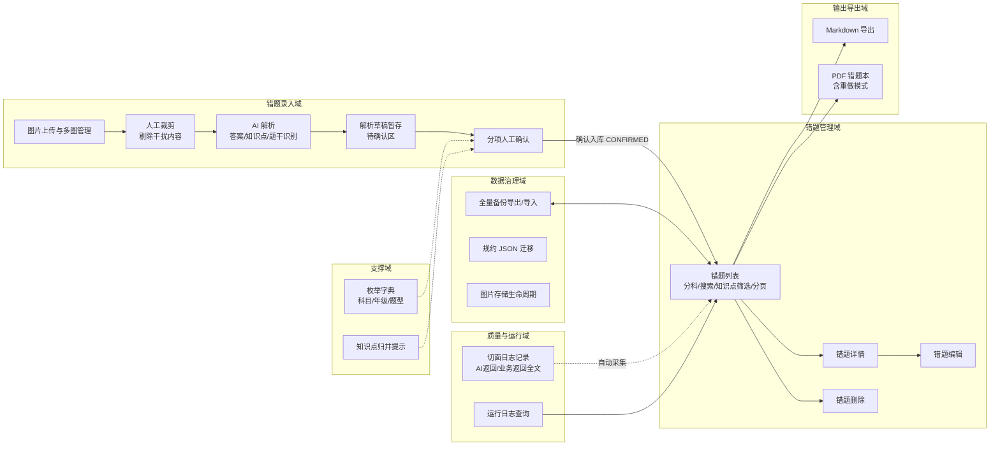
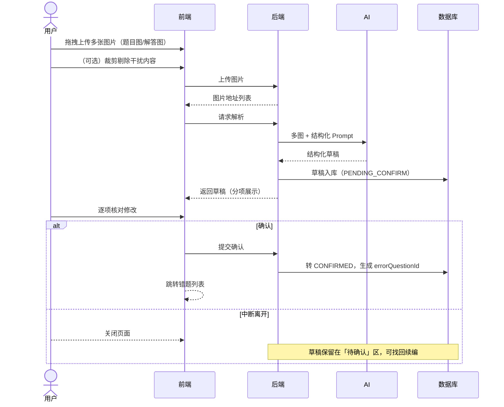

# 错题整理应用 · 业务架构设计

| 项 | 内容 |
|---|---|
| 文档版本 | v1.1 |
| 日期 | 2026-11-11 |
| 作者 | chandler（决策评审）、AI 助手（起草） |
| 状态 | ✅ 已评审通过（评审人：chandler，2026-11-11） |
| 输入 | `.claude.md`、`spec/notebook.md`（含场景设计） |
| 关联文档 | [architecture.md](architecture.md)（技术架构）、[architecture-data.md](architecture-data.md)（数据架构）、[api-contract.md](api-contract.md)（接口契约）、[security.md](security.md)（安全）、[communication-log.md](communication-log.md) |

**修订记录**

| 版本 | 日期 | 变更 | 作者 |
|---|---|---|---|
| v1.0 | 2026-11-11 | 初版：业务域/流程/规则 BR-01~08 | chandler / AI 助手 |
| v1.1 | 2026-11-11 | 同步规约 5（切面日志）：新增「质量与运行域」（切面日志、运行日志查询），BR-09/BR-10；v1 范围补运行日志页；对应 FR-C1~C4 | chandler / AI 助手 |
| v1.2 | 2026-11-11 | 新增标签归类：BR-11，列表查询筛选维度加「标签」，录入/编辑支持手工标注（FR-B6/B7） | chandler / AI 助手 |

---

## 1. 业务目标与背景

错题分散在试卷、练习册上，手工整理成本高。借助 AI 能力实现：上传错题图片 → 自动解析答案与知识点 → 结构化沉淀 → 可筛选、可导出、可迁移。要求简单易用（个人单机场景），错题记录结构化且数据可迁移。

## 2. 业务架构总览

## 3. 业务模块清单

| 业务域 | 模块 | 职责 | 关键业务规则 |
|---|---|---|---|
| 错题录入域 | 图片上传管理 | 多图上传（拖拽/点选）、题目图/解答图角色标注、裁剪、删除 | 每题至少 1 张图；多图上限建议 6 张（防止滥用） |
| | AI 解析 | 按规约数据结构识别字段，生成答案、知识点、解析草稿 | **AI 仅在此环节调用**（BR-01）；失败可重试或转手动填写 |
| | 草稿暂存 | 解析草稿以 `PENDING_CONFIRM` 状态入库，待确认区可找回续编 | 草稿不计入正式错题列表与导出（BR-02） |
| | 分项确认 | 草稿逐项（基本信息/题干/答案/知识点/解析）核对修改后确认入库 | 必填：科目、题干；确认后生成 errorQuestionId，转 `CONFIRMED` |
| 错题管理域 | 列表查询 | 分科 Tab、题目文字模糊搜索、知识点搜索、**标签筛选（BR-11）**、分页、查询/重置 | 仅展示 `CONFIRMED` 数据；`PENDING_CONFIRM` 单列「待确认」入口 |
| | 详情/编辑/删除 | 查看全字段；全字段可编辑；删除需二次确认 | 硬删除：题目记录与图片文件一并物理删除（BR-04） |
| 输出导出域 | Markdown 导出 | 按筛选条件导出规约 JSON 结构的 Markdown | 结构与 `spec/notebook.md` 一致，支持再导入 |
| | PDF 导出 | 按知识点/日期分组排版；重做模式遮盖答案 | 重做模式：答案与解析移至文末答案页 |
| 数据治理域 | 备份迁移 | 全量 JSON 导出/导入，按 errorQuestionId 幂等去重 | 导出字段与规约完全一致（BR-08） |
| 支撑域 | 枚举字典 | 科目/年级/题型枚举供给前端 | 枚举可扩充（规约注明） |
| | 知识点归并 | 保存时匹配已有知识点，提示复用避免同义分叉 | 自由录入，不强约束（BR-03） |
| 质量与运行域 | 切面日志 | AOP 记录业务操作与 AI 调用（返回全文/成败/错误码/耗时）持久化 business_log | BR-09；日志失败不影响业务（FR-C4） |
| | 运行日志查询 | 类型/模块/成败/时间筛选分页，详情查看全文 | BR-10（FR-C3） |

## 4. 核心业务流程

### 4.1 录入解析流程（含草稿暂存）

### 4.2 查询导出流程

用户进入错题记录 → 选科目 Tab → 输入题目文字/知识点条件（可空）→ 查询/重置 → 分页浏览 → 行内查看详情 / 编辑 / 删除 → 或按当前筛选条件导出 Markdown / PDF。

### 4.3 备份迁移流程

全量导出：请求备份 → 后端汇总 `CONFIRMED` 数据 → 生成规约 JSON 数组文件下载。
导入：上传 JSON → 逐条校验 → 按 errorQuestionId 去重（已存在则跳过或覆盖，导入界面可选）→ 报告导入结果。

## 5. 业务规则汇总

| 编号 | 规则 | 来源 |
|---|---|---|
| BR-01 | AI 仅在「录入解析」环节调用，查询/导出/统计/备份零 AI 依赖 | `.claude.md` 约束 |
| BR-02 | 解析草稿服务端暂存（PENDING_CONFIRM），待确认区可找回续编；草稿不进正式列表与导出 | 2026-11-11 15:35 chandler 确认 |
| BR-03 | 知识点自由录入 + 保存时归并提示（匹配已有知识点建议复用），不做强字典约束 | 2026-11-11 15:35 chandler 确认 |
| BR-04 | 已确认错题全字段可编辑；删除为硬删除（记录+图片物理删除，二次确认） | 2026-11-11 15:35 chandler 确认 |
| BR-05 | v1 范围 = 录入/解析/确认/查询/导出/备份；统计看板、线上重做入演进预留 | 2026-11-11 15:35 chandler 确认 |
| BR-06 | 录入支持多图，图片具角色（题目图/解答图），答案可能在答题纸照片中 | `spec/notebook.md` 场景设计 |
| BR-07 | 图片干扰内容通过人工框选裁剪剔除，裁剪在上传后、解析前完成 | `spec/notebook.md` 规约 1 |
| BR-08 | 数据可迁移：导出/导入结构与规约 JSON 完全一致，不锁定 | `.claude.md` 目标 |
| BR-09 | 切面日志：业务操作与 AI 调用经 AOP 统一记录（AI 返回与业务返回**全文**），持久化 business_log，永久保留；日志失败不影响业务；不记录密钥 | 规约 FR-C1/C2/C4，2026-11-11 16:13 chandler 确认 |
| BR-10 | 运行日志查询页：按类型/模块/成败/时间筛选分页查看记录全文（质量查看记录） | 规约 FR-C3，2026-11-11 16:13 chandler 确认 |
| BR-11 | 标签归类：自由文本多标签（JSON 数组存储、手工标注、与知识点语义独立、AI 不自动生成）；列表支持标签模糊筛选 | 规约 FR-B6/B7，2026-11-11 17:05 chandler 确认 |

## 6. v1 范围与演进

**v1 交付边界**（BR-05）：错题录入（多图+裁剪）→ AI 解析 → 草稿暂存 → 分项确认 → 错题管理（查询/详情/编辑/删除）→ 导出（Markdown/PDF）→ 全量备份迁移 → 运行日志查询（BR-10）。

**演进预留**（不在 v1）：统计看板（按科目/知识点/时间分布）、线上重做练习、多用户、AI 服务 Python 拆分、MinIO 对象存储、数据库升级。

## 7. 遗留待确认项

无——本层决策已全部经交互确认，后续进入技术架构设计。
