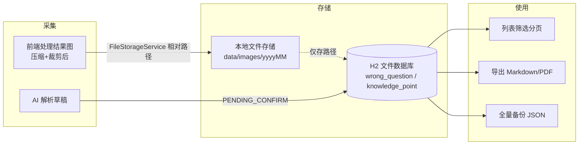
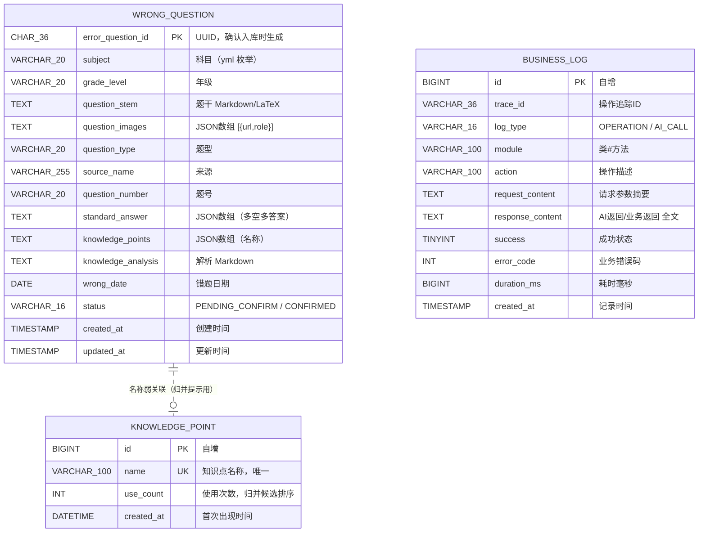

# 错题整理应用 · 数据架构设计

| 项 | 内容 |
|---|---|
| 文档版本 | v1.0 |
| 日期 | 2026-11-11 |
| 作者 | chandler（决策评审）、AI 助手（起草） |
| 状态 | ✅ 已评审通过（评审人：chandler，2026-11-11） |
| 输入 | [architecture-business.md](architecture-business.md)（BR-02/03/04/06/08）、`spec/notebook.md`（错题结构） |
| 关联文档 | [architecture.md](architecture.md)（技术架构）、[api-contract.md](api-contract.md)、[security.md](security.md)、[communication-log.md](communication-log.md) |

**本层确认决策（2026-11-11 15:42，chandler）**：多图采用 JSON 数组+角色标注；知识点采用 JSON+字典表自动累积；DDL 采用 schema.sql 启动执行；枚举采用 yml 配置化。

**v1.1 扩展（2026-11-11 16:13，chandler）**：新增 `business_log` 业务日志表（规约 5 切面日志持久化，永久保留；存储 AI 返回与业务返回全文）。

**v1.2 扩展（2026-11-11 17:05，chandler）**：`wrong_question` 新增 `tags` 字段（自由文本标签 JSON 数组，BR-11/FR-B6）。

---

## 1. 数据架构总览



数据形态三类：**结构化错题数据**（H2 关系表 + JSON 字段）、**图片文件**（本地目录，库中只存相对路径）、**配置数据**（yml 枚举 + AI 配置）。三者以 `data/` 目录为备份单元整体拷贝容灾。

## 2. 数据模型

### 2.1 ER 图



> 知识点与错题为**弱关联**（错题存名称 JSON，不做外键），与业务规则 BR-03「自由录入+归并提示」匹配：保存错题时，新知识点自动累积入字典表并累计 use_count；字典表仅服务归并候选，不约束写入。

### 2.2 表结构 DDL（schema.sql 摘要）

```sql
CREATE TABLE IF NOT EXISTS wrong_question (
  error_question_id   CHAR(36)     NOT NULL,
  subject             VARCHAR(20)  NOT NULL,
  grade_level         VARCHAR(20),
  question_stem       TEXT         NOT NULL,
  question_images     TEXT         NOT NULL,   -- JSON: [{"url":"images/202611/xxx.jpg","role":"QUESTION"}]
  question_type       VARCHAR(20),
  source_name         VARCHAR(255),
  question_number     VARCHAR(20),
  standard_answer     TEXT,                    -- JSON: ["12","1:5"]
  knowledge_points    TEXT,                    -- JSON: ["电压表读数","串联电路分压规律"]
  tags                TEXT,                    -- JSON: ["二刷","易错"]（自由文本标签，BR-11）
  knowledge_analysis  TEXT,
  wrong_date          DATE,
  status              VARCHAR(16)  NOT NULL,   -- PENDING_CONFIRM / CONFIRMED
  created_at          TIMESTAMP    NOT NULL DEFAULT CURRENT_TIMESTAMP,
  updated_at          TIMESTAMP    NOT NULL DEFAULT CURRENT_TIMESTAMP,
  PRIMARY KEY (error_question_id)
);

CREATE TABLE IF NOT EXISTS knowledge_point (
  id         BIGINT       NOT NULL AUTO_INCREMENT,
  name       VARCHAR(100) NOT NULL,
  use_count  INT          NOT NULL DEFAULT 1,
  created_at TIMESTAMP    NOT NULL DEFAULT CURRENT_TIMESTAMP,
  PRIMARY KEY (id),
  CONSTRAINT uk_kp_name UNIQUE (name)
);

CREATE TABLE IF NOT EXISTS business_log (          -- 规约5：切面日志持久化（2026-11-11）
  id               BIGINT       NOT NULL AUTO_INCREMENT,
  trace_id         VARCHAR(36),
  log_type         VARCHAR(16)  NOT NULL,          -- OPERATION / AI_CALL
  module           VARCHAR(100),
  action           VARCHAR(100),
  request_content  TEXT,
  response_content TEXT,                           -- AI 返回 / 业务返回全文
  success          TINYINT      NOT NULL,
  error_code       INT,
  duration_ms      BIGINT,
  created_at       TIMESTAMP    NOT NULL DEFAULT CURRENT_TIMESTAMP,
  PRIMARY KEY (id)
);
CREATE INDEX IF NOT EXISTS IDX_BL_TYPE_TIME ON business_log (log_type, created_at);
```

**与规约 JSON 的映射（BR-08 可迁移）**

| 规约字段 | 表字段 | 说明 |
|---|---|---|
| errorQuestionId / subject / gradeLevel / questionStem / questionType / sourceName / questionNumber / standardAnswer / knowledgePoints / knowledgeAnalysis / wrongDate | 同名蛇形字段 | 一一对应 |
| ——（扩展） | tags | 自由文本标签 JSON 数组（BR-11，2026-11-11 追加）；导出扩展字段 `tags` |
| questionImage（单图） | question_images JSON 中**首个 role=QUESTION 的 url** | 导出时反填，保持规约兼容 |
| ——（扩展） | question_images | 导出扩展字段 `questionImages: [{url, role}]`（新规约场景的多图语义） |
| ——（扩展） | status / created_at / updated_at | 内部管理字段，导出时附带 |

### 2.3 索引设计

| 索引 | 列 | 用途 |
|---|---|---|
| IDX_WQ_SUBJECT_STATUS | subject, status | 分科 Tab + 状态过滤（最高频查询） |
| IDX_WQ_WRONG_DATE | wrong_date | 日期区间筛选与导出分组 |
| IDX_BL_TYPE_TIME | business_log: log_type, created_at | 运行日志页按类型+时间筛选 |
| 主键 | error_question_id | 详情/编辑/删除 |

知识点 LIKE 搜索走 `knowledge_points` TEXT 列全表扫描——个人错题量级（千级）下可接受，规范化改造列入演进。

## 3. 枚举与配置数据

科目/年级/题型存 `application.yml`（2026-11-11 15:42 确认），启动加载供 `/api/meta/enums`，扩充改配置重启生效：

```yaml
app:
  enums:
    subjects: [chinese, math, english, physics, chemistry, biology, politics, history, geography, other]
    grade-levels: [grade1, grade2, ..., grade12]
    question-types: [choice, multiChoice, fillBlank, judge, calculation, experiment, essay, application, other]
    subject-tabs: [math, physics, chemistry]   # 前端分科 Tab（规约场景：数学/物理/化学，可扩充）
```

> 前端分科 Tab 与科目全集区分：Tab 是展示分组，科目全集供录入选择。

## 4. DDL 与脚本管理（2026-11-11 15:42 确认）

- `schema.sql` 建表（`CREATE TABLE IF NOT EXISTS` 幂等）、`data.sql` 初始化（预留，当前无预置数据）。
- Spring Boot SQL init 随启动执行；H2 file 模式下首次启动建库。
- **变更规约**：表结构变更 = 修改 schema.sql + 在文件头部变更注记（日期/变更人/内容）；存量数据迁移用一次性 UPDATE 脚本并归档 `db-changelog.md`。不引入 Flyway（演进预留）。

## 5. 数据生命周期

| 数据 | 生命周期 |
|---|---|
| CONFIRMED 错题 | 永久保留；删除为硬删除（记录+图片文件联动删，BR-04） |
| PENDING_CONFIRM 草稿 | **永久保留 + 手动删除**（2026-11-11 15:45 chandler 确认）；待确认区提供删除操作，草稿删除不联动删图 |
| 图片文件 | 随错题创建而存、随错题硬删而删；无孤儿清理任务（删除事务内同步删文件，失败记日志人工核查） |
| knowledge_point 字典 | 永久累积；use_count 随保存/删除增减；不提供删除（弱关联无一致性风险） |
| business_log 业务日志 | **永久保留**（2026-11-11 16:13 确认）；仅用于质量查看与运行分析，不参与业务事务；估算约 50MB/年（含 AI 返回全文） |

## 6. 容量估算

个人场景：约 2,000 题/年，平均 2 张图 × 200KB ≈ **800MB/年**（含 H2 与图片）。H2 单文件与本地目录在此量级无压力；5 年内无需考虑分库分表或对象存储。

## 7. 遗留待确认项

无——草稿保留策略已于 2026-11-11 15:45 确认（永久保留 + 手动删除），本层决策全部关闭。
