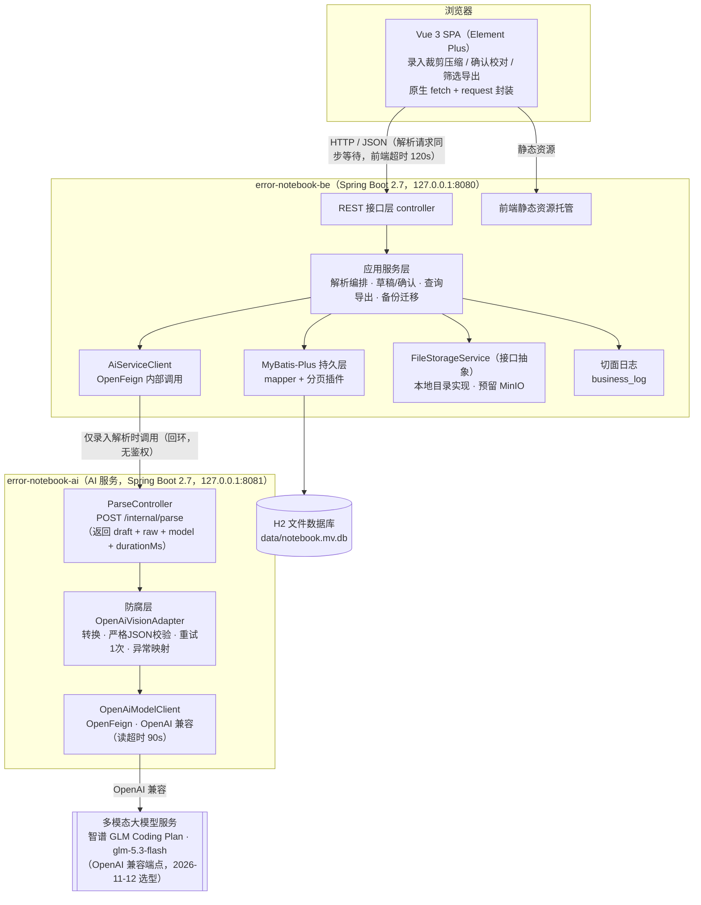
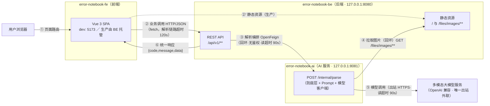
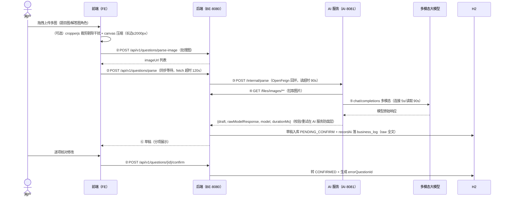

# 错题整理应用 · 技术架构设计

| 项 | 内容 |
|---|---|
| 文档版本 | v3.2 |
| 日期 | 2026-11-12 |
| 作者 | chandler（需求与评审）、AI 助手（起草） |
| 状态 | ✅ 已评审通过（评审人：chandler，2026-11-11） |
| 输入 | `.claude.md`、`spec/notebook.md`、[architecture-business.md](architecture-business.md)（业务架构） |
| 关联文档 | [architecture-business.md](architecture-business.md)（业务架构）、[architecture-data.md](architecture-data.md)（数据架构）、[api-contract.md](api-contract.md)（接口契约）、[security.md](security.md)（安全）、[test-strategy.md](test-strategy.md)（测试策略与 TDD）、[claude_standard.md](../claude_standard.md)（项目标准模板）、[communication-log.md](communication-log.md) |

**修订记录**

| 版本 | 日期 | 变更内容 | 作者 |
|---|---|---|---|
| v1.0 | 2026-11-11 | 初版：技术栈选型、总体架构、数据模型、核心流程 | chandler / AI 助手 |
| v1.1 | 2026-11-11 | 移除 axios 改原生 fetch；持久层 JPA → MyBatis-Plus；文件存储抽象 `FileStorageService`；新增代码质量保障 | chandler / AI 助手 |
| v1.2 | 2026-11-11 | JDK 基线降为 OpenJDK 8（Boot 2.7.x / RestTemplate / g-j-f 1.7）；SonarQube 撤销改 IDE SonarLint；新增 claude_standard.md | chandler / AI 助手 |
| v2.0 | 2026-11-11 | 扩展为完整技术架构：新增工程结构（单模块分包）、AI 同步调用设计（90s 超时）、图片处理链路（前端压缩+裁剪、仅存处理结果图）、异常处理与日志、配置管理；数据模型移至[数据架构文档](architecture-data.md)、接口明细移至[接口契约](api-contract.md) | chandler / AI 助手 |
| v2.1 | 2026-11-11 | 技术栈表补充接口契约与安全层评审项（springdoc-openapi-ui、markdown-it/DOMPurify/KaTeX、commonmark-java）；配置管理落实密钥环境变量注入；部署落实仅本机监听 127.0.0.1 + 免口令 | chandler / AI 助手 |
| v2.2 | 2026-11-11 | AI 调用 RestTemplate → **OpenFeign + 防腐层 ACL**（chandler 指令，方案经确认）；新增 [test-strategy.md](test-strategy.md)（TDD 策略/可测试性设计/39 个规约映射测试用例/JaCoCo 门禁）；质量链补充 @vue/test-utils 组件测试与覆盖率门禁 | chandler / AI 助手 |
| v2.3 | 2026-11-11 | 新增切面日志设计（规约 5）：AOP 记录业务操作（出入参/耗时/错误码）、业务日志持久化 `business_log`（含 AI 返回与业务返回全文、永久保留）、前端「运行日志」查询页；技术栈登记 spring-boot-starter-aop、Lombok；**基础工具层编码待后续指令启动**（本轮仅规约与设计） | chandler / AI 助手 |
| v3.0 | 2026-11-11 | **架构变更（chandler tasks 指令，17:24 确认）**：AI 层拆分为独立 Java 服务 `error-notebook-ai`（Spring Boot 2.7，127.0.0.1:8081）——单体→**双服务**；BE↔AI 走**业务语义内部契约**（api-contract 第 7 章）；防腐层/Prompt/模型调用移入 AI 服务，raw 随响应回传 BE 落业务日志；工程结构改三工程；新增 [tasks.md](tasks.md)（SDD 任务分解，27 任务骨架优先） | chandler / AI 助手 |
| v3.1 | 2026-11-12 | review 补缺（chandler 确认）：§5.1 补失败兜底与编辑重解析分支——转手动填写经 `POST /api/v1/questions/drafts` 创建空草稿（零 AI 调用，TC-P-07）；编辑模式重新解析 confirm 成功后前端联动删旧记录 | chandler / AI 助手 |
| v3.2 | 2026-11-12 | **模型选型落档（chandler 确认）**：智谱 GLM Coding Plan · **glm-5.3-flash**（原生多模态图片输入，套餐内额度 3 倍）；端点用套餐 OpenAI 兼容 `https://open.bigmodel.cn/api/coding/paas/v4`；采样参数按官方推荐 temperature 1 / top_p 0.95（思考型模型，取代原低 temperature 设计，结构化质量由 Prompt+few-shot+防腐层校验保证）；技术栈表/架构图/§5.2 同步 | chandler / AI 助手 |

---

## 1. 设计目标与约束

来源：`.claude.md` 需求 + `spec/notebook.md` 规约与场景设计 + 业务架构（BR-01~BR-08）。

**功能目标**：错题录入（多图+裁剪）→ AI 解析 → 草稿暂存 → 分项确认 → 错题管理（查询/详情/编辑/删除）→ 导出（Markdown/PDF）→ 全量备份迁移。

**非功能约束**
- 简单易用：个人场景、单机部署、开箱即用（单用户免登录）。
- 数据结构化、可迁移：全量导入导出采用规约 JSON 结构。
- **AI 仅在录入解析链路调用**（BR-01），其余链路零 AI 依赖。
- 新引入技术栈/中间件必须评审通过后集成（第 3 章评审表即评审记录）。
- JDK 基线 **OpenJDK 8**（chandler 指定，2026-11-11）。

---

## 2. 总体架构

**单体分层架构**：一个 Spring Boot 进程承担 REST API、AI 集成、持久化与前端静态资源托管，零外部中间件。



### 2.1 三工程调用关系（v3.0 交互示意，2026-11-11 17:37 补充）



**调用关系明细**

| # | 调用方 → 被调方 | 协议 / 地址 | 接口 | 说明 |
|---|---|---|---|---|
| ① | 浏览器 → FE | — | 页面路由 `/questions` 等 | 开发期 Vite devServer 5173（代理→8080）；生产前端产物由 BE 托管 |
| ② | FE → BE | HTTP/JSON `127.0.0.1:8080` | `/api/v1/**`（契约第 3 章） | 原生 fetch + request 封装；解析链路超时 120s，其余 30s；统一业务码拦截 |
| ②′ | 浏览器/FE → BE（生产） | HTTP | `/`（SPA）、`/files/images/**` | 前端构建产物静态托管；错题图片经 BE 静态映射访问 |
| ③ | BE → AI 服务 | HTTP/JSON `127.0.0.1:8081` | `POST /internal/parse`（契约第 7 章） | OpenFeign 声明式；**仅录入解析链路调用**（BR-01）；回环无鉴权；连接 5s/读取 90s |
| ④ | AI 服务 → BE | HTTP（回环） | `GET /files/images/**` | 按图片 URL 拉取裁剪后处理图作为模型输入（实现于任务 A-2） |
| ⑤ | AI 服务 → 大模型 | HTTPS（出站，系统唯一外联） | OpenAI 兼容 `chat/completions`（多模态） | OpenFeign；连接 5s/读取 90s；api-key 仅环境变量 |
| ⑥ | BE → FE | HTTP | `{code, message, data}` | HTTP 恒 200，业务结果由 code 表达（契约第 1 章） |

**边界约束**：BE 不直连大模型；AI 服务无库无状态（模型返回 raw 随 ③ 响应回传，business_log 落在 BE 侧）；FE 不感知 AI 服务存在（对前端而言解析仅是 BE 的一个接口）。

**分层职责**

| 层 | 职责 | 关键点 |
|---|---|---|
| 前端 SPA | 录入（多图/裁剪/压缩）、草稿分项确认、列表筛选、导出下载 | 图片处理在前端完成：cropperjs 裁剪 + canvas 压缩（长边 ≤2000px）后上传处理图；HTTP 用原生 fetch 轻封装 |
| REST 接口层 | 参数校验、路由、文件上传下载 | 无业务逻辑；契约见 [api-contract.md](api-contract.md) |
| 应用服务层 | 录入解析编排、草稿管理、确认入库、查询筛选、导出渲染、备份迁移 | AI 调用仅存在于「解析」用例（BR-01） |
| AI 集成（BE 侧） | `AiServiceClient`（Feign）调用 AI 服务内部契约 | 薄客户端；解析编排/草稿/日志在 BE；预留 AI 服务替换为 Python（内部契约不变） |
| AI 服务（独立） | ParseController + 防腐层 + OpenAI 兼容模型客户端 | 业务语义接口；Prompt/转换/重试/异常映射全在此服务；raw 随响应回传 |
| 持久层 | 错题 CRUD、分页筛选、草稿状态流转 | MyBatis-Plus：BaseMapper + 分页插件 + 条件构造器；SQL 标准方言 |
| 文件存储 | 图片落盘、路径与 URL 管理 | `FileStorageService` 接口抽象，本地目录实现，可替换 MinIO；数据库只存相对路径 |

---

## 3. 技术栈清单与选型评审表

> 新引入项均已明确提示并经 chandler 评审通过（2026-11-11）。

| 分组 | 技术/组件 | 版本 | 用途 | 新引入 | 评审状态 |
|---|---|---|---|---|---|
| 前端 | Vue | 3.x | 前端框架 | 否 | ✅ 通过 |
| 前端 | Vite | 5.x | 开发/构建工具链 | 是 | ✅ 通过 2026-11-11 |
| 前端 | Element Plus | 2.x | UI 组件库 | 是 | ✅ 通过 2026-11-11 |
| 前端 | Vue Router + Pinia | 4.x / 2.x | 路由与状态管理 | 是 | ✅ 通过 2026-11-11 |
| 前端 | 原生 fetch + request 轻封装 | 浏览器内置 | 接口调用/文件上传 | 否 | ✅ 通过 2026-11-11 |
| 前端 | 原生 canvas 图片压缩 | 浏览器内置 | 上传前压缩（长边 ≤2000px），无第三方依赖 | 否 | ✅ 通过 2026-11-11 |
| 前端 | cropperjs | 1.x | 干扰内容人工框选裁剪 | 是 | ✅ 通过 2026-11-11 |
| 后端 | Spring Boot | 2.7.x（OpenJDK 8） | 应用框架 | 否 | ✅ 通过 2026-11-11 |
| 后端 | MyBatis-Plus | 3.5.x | 持久层 | 是 | ✅ 通过 2026-11-11 |
| 后端 | H2 数据库（file 模式） | 2.x | 嵌入式零安装数据库 | 是 | ✅ 通过 2026-11-11 |
| 后端 | Jackson | 随 Boot | 结构化字段序列化 | 否 | ✅ 通过 |
| 后端 | OpenFeign（spring-cloud-starter-openfeign） | 2021.0.x（Boot 2.7 兼容线） | 双向声明式调用：BE→AI 内部契约、AI→模型（OpenAI 兼容）（v3.0） | 是 | ✅ 通过 2026-11-11 |
| 后端 | FileStorageService 接口（JDK NIO 本地实现） | — | 图片存储抽象 | 否 | ✅ 通过 2026-11-11 |
| AI 服务 | 国产多模态模型（**已选型 2026-11-12：智谱 GLM Coding Plan · glm-5.3-flash**，原生多模态，OpenAI Chat Completion 协议端点 `/api/coding/paas/v4`；可经环境变量切换 Qwen-VL 等） | 型号配置化 | 错题图片识别 + 结构化解析 | 是（外部服务） | ✅ 通过 2026-11-11；选型落档 2026-11-12 |
| 导出 | openhtmltopdf + 中文字体 | 1.x | 可打印错题本 PDF | 是 | ✅ 通过 2026-11-11 |
| 导出 | Markdown 模板拼接（无第三方库） | — | 规约 JSON 结构化导出 | 否 | ✅ 通过 |
| 文档 | springdoc-openapi-ui | 1.7.x | Swagger UI 接口文档（Boot 2.7 兼容线） | 是 | ✅ 通过 2026-11-11 |
| 渲染(前端) | markdown-it + DOMPurify + KaTeX | 最新稳定 | 题干/解析 Markdown+LaTeX 渲染，DOMPurify 消毒防 XSS | 是 | ✅ 通过 2026-11-11 |
| 渲染(后端) | commonmark-java | 0.2.x | PDF 导出 Markdown→HTML | 是 | ✅ 通过 2026-11-11 |
| 质量 | husky + lint-staged | 9.x / 15.x | git pre-commit 钩子 | 是 | ✅ 通过 2026-11-11 |
| 质量 | ESLint + Prettier + vue-tsc | 最新稳定 | 前端静态检查 | 是 | ✅ 通过 2026-11-11 |
| 质量 | Vitest | 2.x | 前端单元测试 | 是 | ✅ 通过 2026-11-11 |
| 质量 | @vue/test-utils | 2.x | 前端组件测试（上传器/确认表单/列表交互） | 是 | ✅ 通过 2026-11-11 |
| 质量 | JaCoCo | Maven 插件 | 覆盖率门禁：总行 ≥70%、核心业务包 ≥85% | 是 | ✅ 通过 2026-11-11 |
| 质量 | Spotless（google-java-format 1.7.x） | Maven 插件 | 后端格式统一 | 是 | ✅ 通过 2026-11-11 |
| 质量 | Checkstyle | Maven 插件 | 后端编码规范 | 是 | ✅ 通过 2026-11-11 |
| 质量 | SpotBugs | Maven 插件 | 后端缺陷静态分析 | 是 | ✅ 通过 2026-11-11 |
| 质量 | SonarLint | IDE 插件 | 深度静态分析（非门禁，不部署服务端） | 否 | ✅ 通过 2026-11-11 |
| 质量 | JUnit 5 + MockMvc | 随 Boot | 后端测试 | 否 | ✅ 通过 |
| 后端 | spring-boot-starter-aop | 随 Boot 2.7 | AOP 切面统一业务日志（规约 5） | 是 | ✅ 通过 2026-11-11 |
| 后端 | Lombok | 1.18.x | 样板代码精简（provided scope，不入运行包） | 是 | ✅ 通过 2026-11-11 |

**选型说明**
- **JDK 8 基线**：Spring Boot 2.7.x（3.x 需 JDK 17）；AI 调用 OpenFeign（RestClient 属 Spring 6 不可用，v2.2 起由 Feign+ACL 替代 RestTemplate）；google-java-format 1.7.x（最后支持 JDK 8 的版本线）。
- **前端 HTTP**：原生 fetch 封装 request 工具（超时、统一错误码、JSON、FormData），不引入 axios。
- **图片链路**：裁剪（cropperjs）与压缩（canvas，长边 ≤2000px、JPEG 质量 0.85）**均在前端完成，服务端仅存处理结果图**（2026-11-11 15:38 确认）。
- **AI 调用**：OpenFeign + 防腐层 ACL（2026-11-11 16:04 确认），同步等待模式，详见 5.2。
- **未引入**：Redis、MQ、微服务、对象存储（仅预留接口）、CI 平台、SonarQube 服务端、Flyway——见第 9 章演进预留。

---

## 4. 工程结构（三工程，2026-11-11 17:24 确认：AI 独立服务）

### 4.1 error-notebook-be（后端，单 Maven 模块，8080）

```
error-notebook-be/
├─ pom.xml
└─ src/main/java/com/errnote/
   ├─ NotebookApplication.java
   ├─ config/            # Web、文件上传限制、AiServiceClient(内部 Feign 超时)、MyBatis-Plus(分页) 配置
   ├─ controller/        # REST 接口层（QuestionController、ExportController、BackupController、MetaController）
   ├─ service/           # 应用服务接口与实现（QuestionService、ParseService、ExportService、BackupService）
   │   └─ impl/
   ├─ integration/
   │   ├─ ai/            # AiServiceClient（@FeignClient → AI 服务 /internal/parse）+ 超时/降级配置
   │   └─ storage/       # FileStorageService 接口 + LocalFileStorageService 实现
   ├─ mapper/            # MyBatis-Plus Mapper
   ├─ entity/            # 数据库实体（DO）
   ├─ dto/               # 请求/响应 DTO（parse 草稿、列表查询、分页结果）
   ├─ common/            # 统一响应、错误码、业务异常、全局异常处理、工具类
   ├─ log/               # 切面日志：annotation(LogRecord) / aspect / entity+mapper(business_log) / service / controller(查询)
   └─ resources/
      ├─ application.yml # 基础配置（敏感项环境变量注入，见 security.md）
      ├─ schema.sql      # H2 建表（详见数据架构文档）
      └─ templates/      # Markdown/PDF 导出模板
```

### 4.2 error-notebook-fe（前端，Vite 工程）

```
error-notebook-fe/
├─ package.json          # husky / lint-staged / vitest / vue-tsc 脚本
└─ src/
   ├─ api/               # request.ts（fetch 封装）+ question.ts / meta.ts 模块接口
   ├─ views/             # QuestionListView（列表+Tab+筛选）/ QuestionCreateView（三步流）
   ├─ components/        # ImageUploader（拖拽多图+cropperjs+canvas 压缩）/ KpTags（知识点归并）/ 待定
   ├─ router/            # /questions、/questions/new
   ├─ store/             # Pinia（列表筛选状态、解析草稿）
   ├─ utils/             # image.ts（压缩）、format.ts
   └─ types/             # 与规约 JSON 对齐的 TS 类型
```

### 4.3 error-notebook-ai（AI 服务，单 Maven 模块，8081）

```
error-notebook-ai/
├─ pom.xml               # web + openfeign + validation + springdoc（无数据库依赖）
└─ src/main/java/com/errnote/ai/
   ├─ AiServiceApplication.java
   ├─ controller/        # ParseController（POST /internal/parse，业务语义）
   ├─ acl/               # OpenAiVisionAdapter 防腐层：转换/校验/重试1次/异常映射 42001·42002
   ├─ client/            # OpenAiModelClient（@FeignClient，OpenAI 兼容原生 DTO 同构）
   ├─ prompt/            # system/few-shot 模板（可配置）
   ├─ dto/               # ParseRequest / ParseResponse{draft, rawModelResponse, model, durationMs}
   └─ resources/application.yml   # 模型 base-url/api-key(环境变量)/model；server.port=8081
```

---

## 5. 关键技术设计

### 5.1 录入解析流程（唯一 AI 链路，同步模式）



> **分支语义（2026-11-12 chandler 确认）**：
> - **失败兜底·转手动填写**：解析失败（重试 1 次后仍失败）→ 前端调 `POST /api/v1/questions/drafts` 创建空草稿（PENDING_CONFIRM，**零 AI 调用**，TC-P-07）→ 进入步骤3 人工填写 → confirm 走上图同一路径。
> - **编辑模式重新解析**：换图重新解析经 parse 生成新草稿/新 errorQuestionId → confirm 新记录成功后**前端联动 DELETE 旧 CONFIRMED 记录**，保持编辑语义（TC-N-06）。

### 5.2 AI 集成设计（v3.0：AI 独立服务 + 业务语义内部契约，2026-11-11 17:24 确认）
- **error-notebook-ai 独立 Java 服务**（Spring Boot 2.7，127.0.0.1:8081，同栈）：承载模型调用、Prompt、防腐层全部职责；无数据库、无状态。
- **BE↔AI 内部契约**（[api-contract.md](api-contract.md) 第 7 章）：`POST /internal/parse` 业务语义接口——入参 `images:[{url,role}]`，出参 `{draft, rawModelResponse, model, durationMs}`；仅回环监听、无鉴权。
- **BE 侧**：`AiServiceClient`（Feign）调用内部契约；`ParseService` 编排：调用 → 草稿入库（PENDING_CONFIRM）→ `recordAi` 落业务日志（**raw 全文随响应回传，business_log 仍聚合在 BE 的 H2**）。
- **AI 服务内部**：`OpenAiModelClient`（Feign·OpenAI 兼容，连接 5s/读取 90s）→ `OpenAiVisionAdapter` 防腐层（DTO 转换、严格 JSON 校验、失败重试 1 次、异常映射 42001/42002、raw 原文透出）→ Prompt（仅输出严格 JSON + few-shot + **官方推荐采样参数 temperature 1 / top_p 0.95**——思考型模型，2026-11-12 确认取代原低 temperature 设计；图片按角色排序：题目图在前）。
- 前端 fetch 超时 120s 链路不变；AI 调用仍仅存在于解析用例（BR-01）。
- 预留：AI 服务可平滑替换为 Python 实现（内部契约不变，BE 零改动）。

### 5.3 查询筛选与导出
- 筛选：subject、gradeLevel、questionType、knowledgePoint（LIKE）、wrongDate 区间、sourceName 关键字；MyBatis-Plus 分页插件；仅 `CONFIRMED` 数据。
- Markdown 导出：模板拼接，结构与规约 JSON 一致。
- PDF 导出：openhtmltopdf，按知识点/日期分组；重做模式隐藏答案、答案页置尾。

### 5.4 文件存储（接口抽象，可替换 MinIO）

```java
public interface FileStorageService {
    StoredFile save(InputStream in, String originalFilename); // 存储 → 相对路径
    String getUrl(String relativePath);                       // 相对路径 → 访问 URL
    Resource read(String relativePath);                       // 读取（回显/导出）
    void delete(String relativePath);                         // 删除（随错题硬删联动）
}
```
- `LocalFileStorageService`：`{data.dir}/images/{yyyyMM}/{uuid}.jpg`；**仅存前端处理结果图**（压缩+裁剪后）；静态映射 `/files/images/**`。
- 替换 MinIO：新增实现 + MinIO SDK（届时评审），业务层零改动。
- 备份：`data/` 目录整体拷贝即全量容灾。

### 5.5 数据迁移与备份
全量导出/导入按规约 JSON 结构，幂等去重；明细见[数据架构文档](architecture-data.md)。

### 5.6 异常处理与日志（v2.3：切面日志，规约 5）

**双层日志体系**
- **系统运行日志**：logback 文件（`logs/errnote.log`，滚动归档）——框架/技术栈运行信息与异常堆栈。
- **业务日志**：H2 `business_log` 表持久化（永久保留，2026-11-11 16:13 确认）——质量查看记录与业务分析数据源。

**切面设计**
- `OperationLogAspect`（`@Around` 拦截全部 `@RestController` 方法）：自动记录 模块（类#方法）、请求参数、**业务返回内容（ApiResponse.data 全文）**、成功状态、错误码、耗时 → `BusinessLogService` 入库；日志查询接口自身跳过（防递归）。
- **AI 调用记录**：BE 侧 ParseService 经 `recordAi(...)` 落库——AI 服务在内部契约响应中回传 `rawModelResponse / model / durationMs`，业务日志聚合保持在 BE 的 business_log（TC-G-03）。
- 全局异常：`@RestControllerAdvice` 统一映射错误码（结构见接口契约）；切面对异常路径同样落业务日志（success=false + 错误码，TC-G-02）。
- 可靠性：日志入库失败仅记 logback warn，**不影响业务主流程**（TC-G-04）。
- 脱敏：任何日志不输出 API 密钥（TC-S-03）；AI 返回与业务返回按**原文入库**（质量查看需要，约 50MB/年可承受）。
- 查询：`GET /api/v1/logs` 分页筛选（契约见 [api-contract.md](api-contract.md) 3.12）+ 前端「运行日志」菜单页。

### 5.7 配置管理
- `application.yml` 分层：默认配置内嵌；`config/application.yml` 外置覆盖；环境变量最高优先。
- 关键配置项：`ai.base-url / ai.api-key / ai.model`、`data.dir`、`server.port`、上传大小限制。
- 敏感配置（API Key 等）：**仅环境变量注入**（`ERRNOTE_AI_API_KEY` 等，yml 只留占位），详见[安全设计](security.md)（2026-11-11 15:47 确认）。

---

## 6. 前后端代码质量保障

### 6.1 触发机制（决策：仅 commit 钩子，2026-11-11 chandler 确认）
- 全部自动化质量门禁收敛于 git pre-commit 钩子；不设 CI 平台与 verify 阶段重复检查。
- 前置条件：初始化 git 仓库（编码阶段第一步），husky 统一管理。
- 已知代价与约定：每次提交全量检查预计 1~2 分钟；`--no-verify` 仅限 WIP 提交，正式合入前必须完整通过一次。

### 6.2 pre-commit 钩子执行内容

| 环境 | 检查项 | 工具 | 范围 |
|---|---|---|---|
| 前端 | 格式与规范检查（可自动修复） | lint-staged → ESLint + Prettier | 暂存文件（增量） |
| 前端 | 类型检查 | vue-tsc --noEmit | 全量 |
| 前端 | 单元测试 | Vitest run（纯逻辑 + @vue/test-utils 组件测试） | 全量 |
| 后端 | 代码格式 | Spotless（google-java-format 1.7.x） | 全量 |
| 后端 | 编码规范 | Checkstyle | 全量 |
| 后端 | 缺陷静态分析 | SpotBugs（中高危阻断） | 全量 |
| 后端 | 单元 / 接口测试 | JUnit 5 + MockMvc | 全量 |
| 后端 | 覆盖率门禁 | JaCoCo check：总行 ≥70%，核心业务包 ≥85% | 全量 |

### 6.3 深度静态分析（决策：IDE SonarLint，2026-11-11 chandler 确认）
- 不部署 SonarQube 服务端，由 IDE SonarLint 插件承担，实时反馈、非门禁；门禁链静态分析以 SpotBugs 为终点；v1.1 的 SonarQube 方案撤销、未集成。

### 6.4 检查规则基线
- 后端：google-java-format 1.7.x 格式；Checkstyle（Google 规则裁剪）；SpotBugs 中高危阻断。
- 前端：ESLint `vue3-recommended` + `@typescript-eslint`；Prettier；vue-tsc 零 error。
- IDE 辅助（非门禁）：SonarLint、Checkstyle、ESLint / Volar。

### 6.5 TDD 与测试策略（2026-11-11 16:04 确认）
- 核心业务域（解析编排、防腐层、知识点归并、导入导出、文件存储、前端核心工具与组件）实施**严格 TDD**（红→绿→重构）；CRUD 通道随实现补测。
- 测试用例从规约与用户场景提炼（**55 例**：TC-U/P/C/D/L/N/E/S 八组 46 例 + TC-G 切面日志 5 例 + TC-T 标签 4 例）；业务域单测**不依赖具体实现**（接口 mock + 纯函数化 + Clock/IdGenerator 注入）。
- 详见 [test-strategy.md](test-strategy.md)。

---

## 7. REST API（指针）

> **单一事实来源：[api-contract.md](api-contract.md)（v1.1）**。本章仅列端点分组索引，路径、请求/响应体、错误码一律以契约为准（ISS-01 勘误：本章不再重复维护明细，防漂移）。
>
> 分组：错题录入解析（parse-image / parse / confirm）· 错题管理（列表筛选 / 详情 / 编辑 / 硬删）· 草稿管理（drafts）· 导出（export）· 备份迁移（backup）· 元数据（meta）· 运行日志（logs）。

---

## 8. 部署架构

单机双服务，`java -jar` 直接运行，无外部中间件（v3.0）：

```
errnote/
├─ error-notebook-be.jar   # 后端（8080）：内嵌 H2 + 前端构建产物 + 切面日志
├─ error-notebook-ai.jar   # AI 服务（8081）：模型调用/防腐层/Prompt（无库无状态）
├─ data/                   # 数据目录（BE）：整体拷贝即备份迁移
│  ├─ notebook.mv.db       # H2 数据库文件
│  └─ images/202611/       # 处理结果图（按月分目录）
├─ config/                 # 两服务外置配置（BE：data.dir/ai-service.url；AI：模型 base-url/model；api-key 均环境变量）
└─ logs/                   # 两服务运行日志
```
- 启动顺序：建议先 AI（8081）后 BE（8080）；BE 启动不强依赖 AI 在线，仅解析调用时需要。
- 环境要求：OpenJDK 8+；浏览器访问 `http://localhost:8080`。
- 监听与访问控制：双服务均仅 `127.0.0.1` + 免口令（2026-11-11 15:47 确认，详见[安全设计](security.md)）。
- 开发期工具（不进运行时）：husky git 钩子、IDE SonarLint。

---

## 9. 演进预留

| 方向 | 预留措施 |
|---|---|
| AI 服务拆分 Python | `AiParseService` 接口边界已隔离 |
| AI 异步任务化 | 解析服务编排集中在 ParseService，可平滑改 taskId+轮询 |
| MinIO 对象存储 | `FileStorageService` 已接口化 |
| 数据库升级 MySQL/PostgreSQL | MyBatis-Plus + 标准 SQL 方言 |
| 统计看板 / 线上重做 | 业务架构 BR-05 演进项；数据模型可扩展作答记录表 |
| 多用户认证 | 数据模型可扩展 owner 字段 |
| JDK / Spring Boot 升级 | OpenJDK 8 + Boot 2.7（javax）；升 Boot 3.x 时迁移 javax→jakarta、spring-cloud-openfeign 升 4.x（ACL 隔离使 DTO 变更影响面收敛在 client 包） |

---

## 10. 沟通记录

全部交互确认记录见 [communication-log.md](communication-log.md)。
